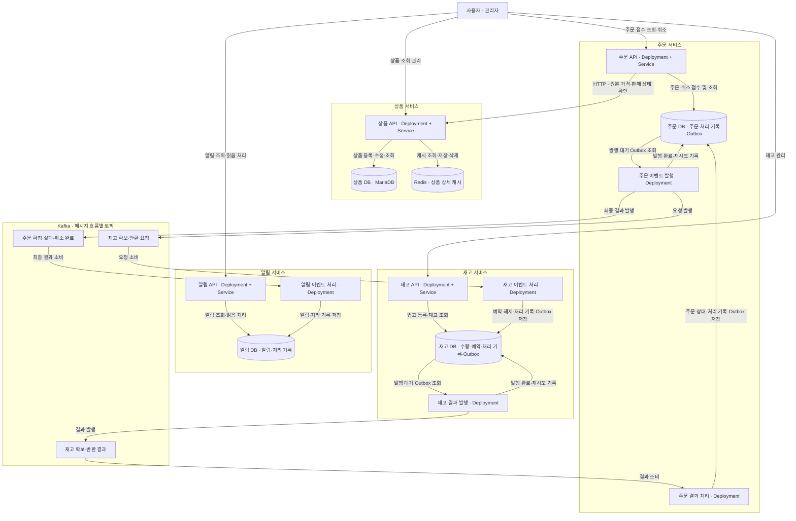

# 상품 주문·재고 서비스 설계

## 1. 서비스별 구현 범위

| 서비스 | 구현할 기능 | 직접 관리할 데이터 |
|---|---|---|
| 상품 서비스 | 상품 등록·수정·판매 중지, 상품 목록·상세 조회, 조회 캐시 관리 | 상품명·설명·가격·판매 상태 |
| 주문 서비스 | 주문 접수, 주문 목록·상태 조회, 재고 처리 결과 반영, 주문 취소, 실패·미완료 주문 조회 | 주문·주문 상품·주문 상태 |
| 재고 서비스 | 입고 등록, 재고 조회, 주문 수량 예약, 예약 실패 처리, 취소 시 예약 해제 | 재고 수량·주문별 예약 내역 |
| 알림 서비스 | 주문 확정·실패·취소 이벤트 처리, 사용자 알림 목록·읽음 처리, 발송 실패 관리 | 사용자 알림·처리 상태 |

알림 기능의 첫 범위는 서비스 안에서 조회하는 알림을 저장하고 제공하는 것이다. 이메일·문자 전송은 이후 확장 대상으로 둔다. 초기 알림 실패 관리는 이벤트 처리와 알림 저장 실패의 확인·재시도를 의미한다.

## 서비스 구성도

